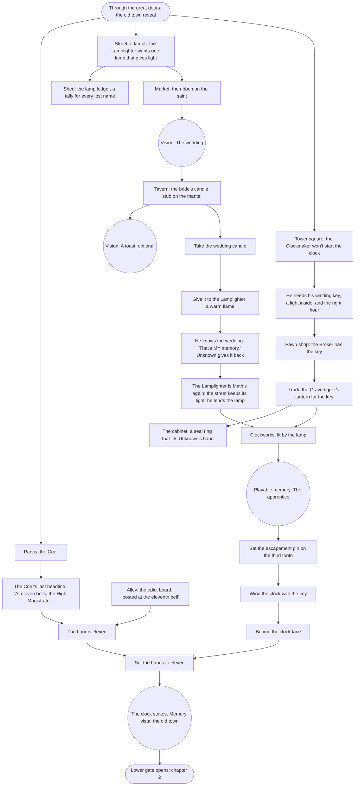

# Chapter 1 — The Nameless Streets: puzzle chart

Status: plan 008 slice 5, written from the signed bible (`bible.md` §6) and
the atlas. Twelve rooms. Three threads run side by side and meet at the
stopped clock. The lower gate to the drowned quarter is wound to the clock
and opens only when it strikes.

- **The lamp:** the Lamplighter's flame, and through it light for the dark
  clockworks.
- **The key:** the Clockmaker pawned his winding key with the Broker.
- **The hour:** the clock has to be set to the hour it stopped, or it
  "strikes the wrong thing".

## Rooms and exits

| Room | Exits |
|---|---|
| `cathedral_parvis` | the great doors to `cathedral_nave`; left to `street_of_lamps`; right to `alley_of_doors` |
| `street_of_lamps` | parvis; the shed door to `lamplighter_shed`; on to `market_square` |
| `lamplighter_shed` | door to `street_of_lamps` |
| `market_square` | `street_of_lamps`; the shop door to `pawn_shop`; on to `canal_bridge` |
| `pawn_shop` | door to `market_square` |
| `canal_bridge` | `market_square`; over to `clock_tower_base` |
| `alley_of_doors` | parvis; the tavern door to `tavern_lost_name` |
| `tavern_lost_name` | door to `alley_of_doors` |
| `clock_tower_base` | `canal_bridge`; the tower door to `clockworks` (dark until the warm lamp); the stair down to `lower_gate` |
| `clockworks` | down to `clock_tower_base`; the ladder up to `clock_face` |
| `clock_face` | down to `clockworks` |
| `lower_gate` | up to `clock_tower_base`; the portcullis to chapter 2's `flooded_stair` (shut until the clock strikes) |

## Items

| Item | From | Used on |
|---|---|---|
| `lantern` (from the prologue) | — | the Broker, for the key |
| `winding_key` | the Broker | the clockworks' winding post |
| `wedding_candle` | the tavern mantel, after the vision "The wedding" | the Lamplighter |
| `warm_lamp` | the Lamplighter, once his flame is warm | lights the clockworks (carried) |
| `seal_ring` | the Broker's cabinet, after the trade | carried to chapter 3's records gate |

## Memories

| Memory | Kind | Where | Whose |
|---|---|---|---|
| `ch1_wedding` "The wedding" | vision | market, the ribbon on the saint | the Lamplighter's: his daughter's wedding, the lamps lit gold by the bride's candle |
| `ch1_toast` "A toast" | vision (optional) | tavern bar | the wedding guests': a name shouted, then forgotten mid-word |
| `ch1_apprentice` "The apprentice" | playable memory | clockworks | the Clockmaker's: how the pin sits on the third tooth |
| `ch1_old_town` "The old town" | memory vista | clock face | the city's, as the hour strikes |

## The twist

When the Lamplighter's flame warms, Unknown describes the wedding he saw.
The Lamplighter answers: "That's my memory. How do you have it?" Unknown
gives it back, and the Lamplighter remembers his name, Mathis. The street of
lamps keeps its warm light from then on (`mathis_named`). Unknown learns he
is carrying other people's memories (fact `memories_not_mine`). This is
`bible.md` §5's chapter 1 turn, placed mid-chapter at the lamp so that the
clock's strike can close the chapter.

## Flags, in order (the hint goals)

`ch1_arrived` → `crier_met` → `lamplighter_met` → `clockmaker_met` → memory
`ch1_wedding` → `got_wedding_candle` → `mathis_named` → `got_winding_key` →
`knows_eleven` → memory `ch1_apprentice` → `escapement_set` →
`clock_wound` → `clock_struck`.
