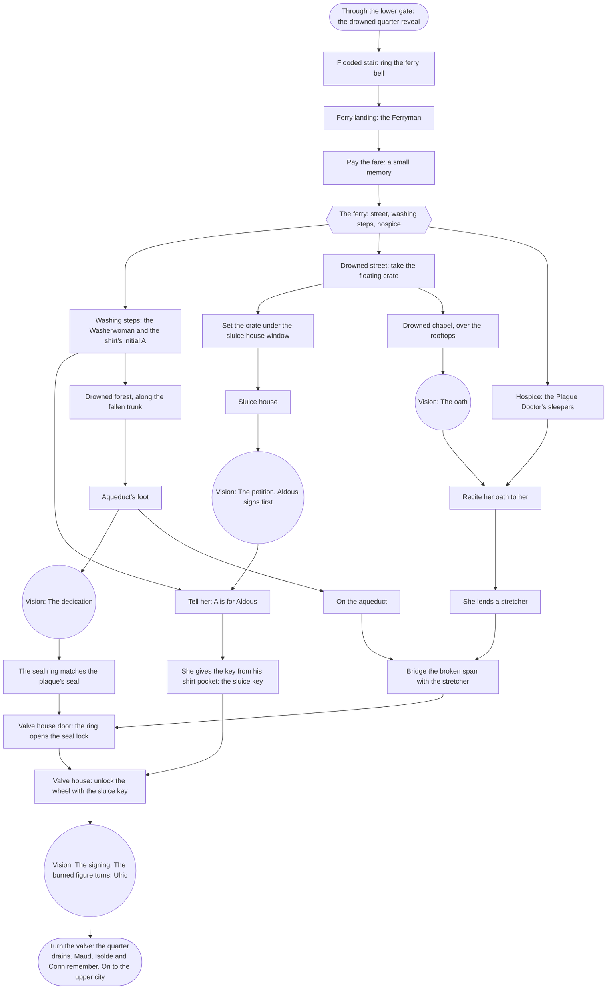

# Chapter 2 — The Drowned Quarter: puzzle chart

Status: plan 008 slice 6, written from the signed bible (`bible.md` §6) and
the atlas. Eleven rooms. The Ferryman's boat joins the drowned rooms. Two
threads open the way up the aqueduct to the valve house, where Unknown learns
who he was.

- **The washer's thread:** whose initial is on the shirt she scrubs. It ends
  with the key to the valve house's wheel.
- **The doctor's thread:** the oath she forgot. It ends with a stretcher to
  bridge the broken aqueduct.

The seal ring from chapter 1 matches the aqueduct's seal and opens the valve
house.

## Rooms and exits

| Room | Exits |
|---|---|
| `flooded_stair` | up to `lower_gate`; along the quay to `ferry_landing` |
| `ferry_landing` | the stair to `flooded_stair`; the ferry, once paid, to `drowned_street`, `washing_steps` or `hospice_on_stilts` |
| `drowned_street` | the ferry back to `ferry_landing`; over the rooftops to `drowned_chapel`; the window to `sluice_house` (once the crate is set) |
| `sluice_house` | the window to `drowned_street` |
| `drowned_chapel` | the rooftops to `drowned_street` |
| `washing_steps` | the ferry back; the path to `drowned_forest` |
| `hospice_on_stilts` | the ferry back |
| `drowned_forest` | `washing_steps`; the trunk to `aqueduct_foot` |
| `aqueduct_foot` | `drowned_forest`; the maintenance stair to `aqueduct_channel` |
| `aqueduct_channel` | down to `aqueduct_foot`; over the span to `valve_house` (once bridged, and the door unsealed) |
| `valve_house` | back to `aqueduct_channel`; at the chapter's end, the ferry to chapter 3's `upper_avenue` |

The ferry is a conversation with the Ferryman: Unknown names a landing and
the boat takes him there. Each ferry room has a "Ferry" exit back to the
landing.

## Items

| Item | From | Used on |
|---|---|---|
| `crate` | floating in `drowned_street` | the sluice house window |
| `sluice_key` | the Washerwoman, once told of Aldous | the valve house wheel |
| `stretcher` | the Plague Doctor, once reminded of her oath | the broken span |
| `seal_ring` (chapter 1) | — | the aqueduct plaque, and the valve house door |

## Memories

| Memory | Kind | Where | Whose |
|---|---|---|---|
| `ch2_petition` "The petition" | vision | sluice house wheel | Aldous's: the keepers' petition against the Magistrate, signed first by A. |
| `ch2_oath` "The oath" | vision | drowned chapel altar | the Plague Doctor's: "Remember them, every one, by name." |
| `ch2_dedication` "The dedication" | vision | aqueduct plaque | a crowd's: the aqueduct opened by a burned-out figure with a seal |
| `ch2_quarter` "The quarter as it was" | vision (the area's memory vista) | the aqueduct's view | the city's |
| `ch2_signing` "The signing" | vision | valve wheel | the keepers' last: their names struck by the burned figure, who turns. It is Unknown. |

## The turn

At the valve, the burned figure turns and Unknown sees it from the inside.
The voice that strikes the names is his own. He learns his name, Ulric, and
what he was (facts `i_am_ulric` and `the_flood`). Draining the quarter gives
back the three memories he holds: Maud remembers Aldous, Isolde her oath and
Corin where he was going. Their subtitles turn to their names (speaker
aliases).

## Flags, in order (the hint goals)

`ch2_arrived` → `ferry_called` → `ferry_paid` → `got_crate` → `crate_set` →
memory `ch2_petition` → `maud_told` → memory `ch2_oath` → `doctor_told` →
memory `ch2_dedication` → `seal_matched` → `span_bridged` →
`valve_door_open` → `valve_unlocked` → memory `ch2_signing` → `ch2_done`.
