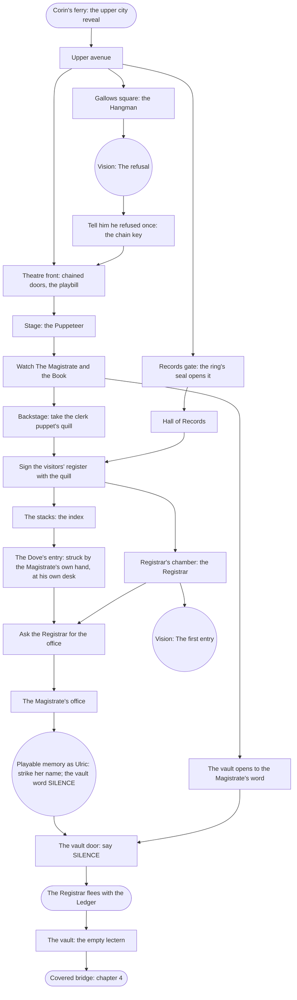

# Chapter 3 — The Hall of Records: puzzle chart

Status: plan 008 slice 7, written from the signed bible (`bible.md` §6) and
the atlas. Twelve rooms. Two threads lead into the Hall of Records:

- **The gallows:** the Hangman keeps the theatre's chain key. He gives it up
  once Unknown shows him the one time he refused.
- **The theatre:** the Puppeteer's show tells where the Ledger is, and that
  its vault opens to a word the Magistrate wrote once, at his own desk. Her
  clerk puppet holds a real clerk's quill.

Inside, the quill signs the visitors' register, the stacks' index points to
the Magistrate's office, and the Registrar lets Unknown into it. There, a
**playable memory as Ulric** gives the vault's word, and Unknown learns that
he struck the Dove's name. The vault opens, and the Registrar runs for the
belfry with the book.

## Rooms and exits

| Room | Exits |
|---|---|
| `upper_avenue` | `gallows_square`; `theater_facade`; `records_gate` |
| `gallows_square` | back to `upper_avenue` |
| `theater_facade` | `upper_avenue`; the doors to `theater_stage` (chained until the chain key) |
| `theater_stage` | `theater_facade`; the wings to `theater_backstage` |
| `theater_backstage` | the wings to `theater_stage` |
| `records_gate` | `upper_avenue`; the gate to `hall_of_records` (sealed until the ring) |
| `hall_of_records` | `records_gate`; `archive_stacks` and `registrar_chamber` (once signed in); `magistrate_office` (once the Registrar allows it) |
| `archive_stacks` | `hall_of_records` |
| `magistrate_office` | `hall_of_records` |
| `registrar_chamber` | `hall_of_records`; the vault door to `ledger_vault` (once opened) |
| `ledger_vault` | `registrar_chamber`; the far door to `covered_bridge` |
| `covered_bridge` | `ledger_vault`; on to chapter 4's `cathedral_roof` |

## Items

| Item | From | Used on |
|---|---|---|
| `chain_key` | the Hangman, after the vision | the theatre's chained doors |
| `clerk_quill` | the clerk puppet backstage, after the show | the visitors' register |
| `seal_ring` (chapter 1) | — | the records gate |

## Memories

| Memory | Kind | Where | Whose |
|---|---|---|---|
| `ch3_refusal` "The refusal" | vision | gallows beam | the Hangman's: he refuses to hang a nameless man, and the burned figure strikes his name for it |
| `ch3_opening_night` "Opening night" | vision (optional) | the stage boards | the Puppeteer's: a full house |
| `ch3_first_entry` "The first entry" | vision | Registrar's desk | the young clerk's: the Magistrate tests the Ledger on him first |
| `ch3_office` "The Magistrate's desk" | playable memory | the office desk | Ulric's own: the last thing he took was hers. He writes the vault word, SILENCE, and strikes the Dove's name |

## Facts

`first_entry` (the Registrar was the Ledger's first entry, and he made Ulric
its last) and `struck_the_dove` (Ulric took the Dove's name himself, at his
own desk).

## Flags, in order (the hint goals)

`ch3_arrived` → `hangman_met` → memory `ch3_refusal` → `got_chain_key` →
`theater_open` → `saw_show` → `got_quill` → `records_gate_open` →
`signed_in` → `knows_office` → `office_permitted` → memory `ch3_office` →
`vault_open` → `ch3_done`.
