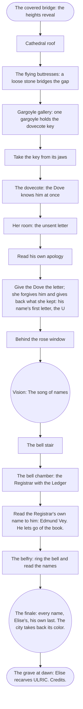

# Chapter 4 — The Dovecote: puzzle chart

Status: plan 008 slice 8, written from the signed bible (`bible.md` §6) and
the atlas. Ten rooms: the cathedral's heights, the finale and the epilogue.
One line leads through the Dove. Unknown has to face her before he can face
the Registrar.

## Rooms and exits

| Room | Exits |
|---|---|
| `cathedral_roof` | from the covered bridge; along the ridge to `buttress_walk` |
| `buttress_walk` | `cathedral_roof`; across to `gargoyle_gallery` (once the stone bridges the gap) |
| `gargoyle_gallery` | `buttress_walk`; on to `dovecote` |
| `dovecote` | `gargoyle_gallery`; the trapdoor to `dove_room` (once the Dove is met); the tower door to `rose_window_ledge` (once forgiven) |
| `dove_room` | up to `dovecote` |
| `rose_window_ledge` | `dovecote`; the stair door to `bell_stair` |
| `bell_stair` | `rose_window_ledge`; up to `bell_chamber` |
| `bell_chamber` | `bell_stair`; the ladder to `belfry_top` (once the Registrar lets go) |
| `belfry_top` | the finale, then `grave_at_dawn` |
| `grave_at_dawn` | the end |

## Items

| Item | From | Used on |
|---|---|---|
| `loose_stone` | the roof ridge | the buttress gap |
| `dovecote_key` | a gargoyle's jaws | the dovecote door |
| `unsent_letter` | the Dove's desk | the Dove |
| `ledger` | the Registrar, once named | the bell, in the belfry |

## Memories

| Memory | Kind | Where | Whose |
|---|---|---|---|
| `ch4_song` "The song of names" | vision | the rose window | Elise's: she sings the names of the taken, and the Magistrate steps forward |
| `ch4_city` "The city restored" | vision (the finale's memory vista, and then the present) | the belfry | everyone's |

## Facts

`elise` (her name was Elise, and she forgave him) and `ulric` (the journal's
name field fills in at the end).

## Flags, in order (the hint goals)

`ch4_arrived` → `got_stone` → `buttress_bridged` → `got_dovecote_key` →
`dove_met` → `got_letter` → `dove_forgave` → memory `ch4_song` →
`registrar_named` → `got_ledger` → `names_returned` → `epilogue_seen`.
