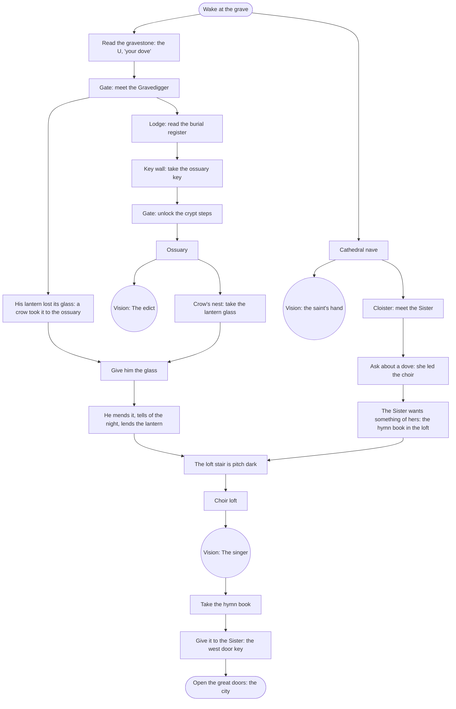

# Prologue — The Grave: puzzle chart

Status: plan 008 slice 4, written from the signed bible (`bible.md` §6,
decision #48). Seven rooms: the two built in plans 002 and 007, plus P1–P5
from `atlas.md`. Two threads run side by side, the cemetery and the
cathedral. They meet at the choir loft's dark stair: the cathedral thread
needs the lantern that the cemetery thread earns.

## Rooms and exits

| Room | Exits |
|---|---|
| `cemetery_grave` | east to `cathedral_nave`; **new:** west to `cemetery_gate` |
| `cemetery_gate` (P1) | east to `cemetery_grave`; lodge door to `sexton_lodge`; crypt steps to `ossuary` (locked until the ossuary key) |
| `sexton_lodge` (P2) | door to `cemetery_gate` |
| `ossuary` (P3) | stair to `cemetery_gate` |
| `cathedral_nave` | west to `cemetery_grave`; **new:** the aisle arch to `cathedral_cloister`; the great doors (right) to chapter 1's `cathedral_parvis`, locked until the west door key |
| `cathedral_cloister` (P4) | doorway to `cathedral_nave`; turret stair to `choir_loft` (dark until Unknown has the lantern) |
| `choir_loft` (P5) | stair to `cathedral_cloister` |

## Items

| Item | From | Used on |
|---|---|---|
| `ossuary_key` | the lodge's key wall, after reading the register | the crypt steps |
| `lantern_glass` | the crow's nest in the ossuary | the Gravedigger |
| `lantern` | the Gravedigger, for the glass | lights the loft stair (carried, not used up) |
| `hymn_book` | the loft's stand, after the vision | the Sister |
| `west_door_key` | the Sister, for the book | the great doors |

## Memories

| Memory | Kind | Where | Whose (bible rule 5) |
|---|---|---|---|
| `cathedral_statue` "The saint's hand" | vision (built) | nave statue | the Dove's |
| `prologue_edict` "The edict" | vision | ossuary niches | a family's, whose father's name was scraped off |
| `prologue_singer` "The singer" | vision | loft hymn book | the Dove's |

## Flags, in order (the hint goals)

`tombstone_read` → `gd_met` → `register_read` → `got_ossuary_key` →
`ossuary_open` → `got_lantern_glass` → `gd_lantern_mended` → `sister_met`
→ `sister_dove` → memory `prologue_singer` → `got_hymn_book` →
`got_west_door_key` → `west_doors_open`.

The Gravedigger's story of the night (`gd_told_night`) and the two other
visions are optional, but the journal records them.

## The web demo

The browser build ends at the great doors. The doors open on a closing card
in place of `cathedral_parvis`, which is in chapter 1 and left out of the
demo (decision #20).
